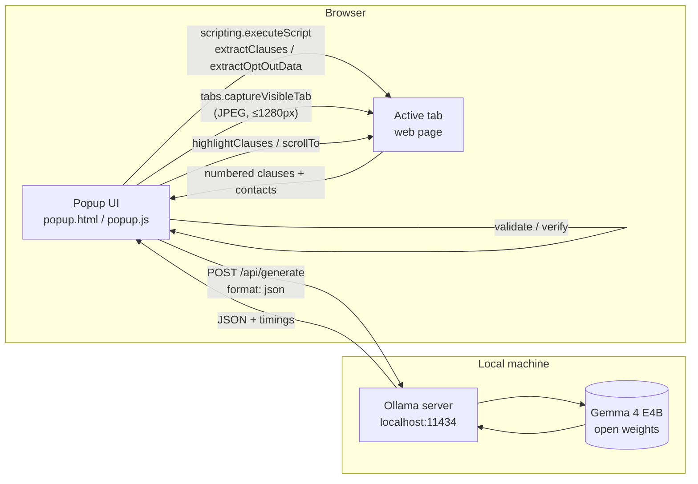

# FinePrint 🛡️

**An on-device AI auditor for Terms of Service, privacy policies and manipulative UI, built on open-weight Gemma 4.**

FinePrint is a Manifest V3 browser extension. It reads the legal text on the page you're viewing, grades it **A–F**, highlights risky clauses in place, finds the **opt-outs** the policy offers and drafts the emails for them. It can also look at a **screenshot** of the page to catch dark patterns. All model inference runs locally through [Ollama](https://ollama.com). No page text, screenshot or personal data leaves the machine.

| | |
|---|---|
| **Model** | Gemma 4 E4B (default) / E2B, open weights, via Ollama |
| **Modalities used** | Text (policy analysis) + Vision (screenshot dark-pattern detection) |
| **Languages** | Explanations in English, Hindi, Hinglish, Tamil, Bengali, Marathi, Spanish, French, German, Japanese |
| **Network calls** | Only `http://localhost:11434` (Ollama). Nothing else. |
| **License** | MIT |

---

## Contents
1. [Features](#features)
2. [Architecture](#architecture)
3. [Pipelines in detail](#pipelines-in-detail)
4. [Hallucination controls](#hallucination-controls)
5. [Model and inference settings](#model-and-inference-settings)
6. [Privacy and permissions](#privacy-and-permissions)
7. [C++ test server](#c-test-server)
8. [Agent skill / CLI](#agent-skill--cli)
9. [Setup](#setup-macos)
10. [Demo walkthrough](#demo-walkthrough)
11. [Project structure](#project-structure)
12. [Troubleshooting](#troubleshooting)
13. [Limitations](#limitations)
14. [Roadmap](#roadmap)

---

## Features

| Feature | What it does | Gemma 4 capability used |
|---|---|---|
| 📜 **Terms audit** | A–F grade, a short verdict, and per-clause findings (high / medium / safe) highlighted on the page with plain-language tooltips. Click a finding in the popup to jump to the clause. | Long-context text reasoning, structured JSON output |
| 👁️ **Dark-pattern scan** | Captures the visible tab and detects manipulative UI: hidden reject buttons, pre-ticked consent boxes, confirmshaming, fake urgency, sneaked-in fees, auto-renewals. | **Multimodal vision** |
| 🚪 **Opt-out finder** | Lists every opt-out the policy offers (marketing, ad sharing, AI training, …). Each comes with a ready-to-send email or a link to the right settings page, and quotes the policy's own sentence. | Extraction + entity matching |
| 🌐 **Multilingual output** | All explanations in the user's chosen language; legal quotes stay verbatim. | Multilingual generation (140+ languages) |
| ⚡ **On-device telemetry** | Shows the model, latency and tokens/sec for every run. | — |
| 🧩 **Agent skill + CLI** | The same audit, usable from the terminal or by any AI agent. | — |

---

## Architecture



**Design principles**
1. **Code extracts, the model judges, code verifies.** Anything the user acts on (a quote, an email address, a link) comes from the page itself, never from model output.
2. **Structured I/O only.** Every request uses Ollama's `format: "json"` with an explicit schema in the prompt. Responses are parsed, normalised and filtered before rendering.
3. **No hidden fallbacks.** If Ollama is unreachable, the user sees the real error and the exact fix. The extension never shows canned results.
4. **Zero network surface.** The only allowed host is `localhost:11434`. There is no backend server and no analytics.

---

## Pipelines in detail

### 1. Terms audit (`auditTerms`)

```
page DOM ─► extractClauses() ─► numbered clauses ─► Gemma (JSON) ─► filter/sort ─► highlightClauses() + popup cards
```

1. **Extraction (runs in the page).** Collects leaf `p, li, td, dd` elements longer than 40 characters. Elements matching a risk keyword pattern (`arbitration|third-party|waive|perpetual|biometric|sell|share|…`) go first, the rest after. The total is capped at **9,000 characters / 30 clauses** to fit a small model's useful context. Each element gets a `data-fp-id` attribute so the findings can be mapped back to the exact DOM node.
2. **Prompt.** A negation-aware auditor prompt ("*we never sell data*" counts as a protection) with a fixed severity rubric and a strict JSON contract:
   ```json
   {"grade":"A|B|C|D|F","summary":"≤8 words",
    "findings":[{"id":3,"severity":"high|medium|safe","category":"2-3 words","plain_english":"…"}]}
   ```
3. **Post-processing.** Drops unknown severities, coerces IDs to numbers and sorts high → medium → safe.
4. **Rendering.** `highlightClauses()` is injected back into the page. It colours each clause by severity (🚩 / ⚠️ / ✅), adds a badge and puts the plain-language explanation in a tooltip.

### 2. Visual dark-pattern scan (`visionScan`)

```
tabs.captureVisibleTab ─► downscale (≤1280px, JPEG q0.8) ─► base64 ─► Gemma vision (JSON) ─► risk + pattern cards
```

- Retina screenshots are downscaled in the popup with `OffscreenCanvas` (with a `<canvas>` fallback) to cut the number of image tokens and keep latency low.
- The prompt lists the dark-pattern families covered by India's *CCPA Guidelines for Prevention and Regulation of Dark Patterns, 2023* (false urgency, basket sneaking, confirmshaming, …). It requires evidence for each finding: *"only report what you can actually see"*.
- Output contract: `{"risk":"low|medium|high","verdict":"…","dark_patterns":[{"name","evidence","severity"}]}`.

### 3. Opt-out finder (`findOptOuts`)

```
page DOM ─► extractOptOutData() ─┬─► clauses  [1..n]        ─┐
                                 └─► contacts [C1..Cn]      ─┴─► Gemma: match IDs ─► verify ─► mailto / settings link
```

1. **Deterministic contact harvesting (runs in the page).** Collects every `mailto:` link, every email-shaped string in the body text, and every `http(s)` link whose text or href matches `setting|preferenc|unsubscribe|opt|privacy|do-not-sell|consent|choices|ads|grievance|request`. Each contact gets an ID (`C1`, `C2`, …).
2. **Matching, not generation.** Gemma receives the clauses and the contact list. It returns only references:
   ```json
   {"opt_outs":[{"what":"Marketing emails","clause_id":1,
     "quote":"exact sentence from the clause","contact_id":"C1","how":"…"}],
    "grievance_contact_id":"C2"}
   ```
3. **Verification** (see below). Unverifiable items are removed, and the UI reports how many.
4. **Action.** The email body is filled from a **template in code**, quoting the policy back to the company. The user's own mail client opens with recipient, subject and body pre-filled. Nothing is sent automatically. Links open the policy's own settings page. If an opt-out has no contact, the request is routed to the grievance officer when one is listed. Mailto URLs longer than 1,900 characters fall back to the clipboard.

---

## Hallucination controls

Small models make things up. FinePrint treats model output as **untrusted input**:

| Risk | Control |
|---|---|
| Model invents a clause | Findings reference clause **IDs** assigned by code. Unknown IDs can't be highlighted. |
| Model invents a quote | `quoteIsOnPage()` normalises Unicode, quotes and punctuation. It requires an exact substring match, or ≥85% word overlap for quotes of 4+ words, against **that specific clause**. Failures are dropped. |
| Model invents an email address / URL | The model can only return a `contact_id` that already exists in the harvested list. Addresses are never taken from model text. |
| Model returns malformed JSON | `parseJsonLoose()` tries a strict parse, then extracts the outermost `{…}`. On failure the user sees a clear error. |
| Model output injected into the UI | Every model string is HTML-escaped (`esc()`) before rendering. Page-side highlights use `textContent`. |
| Translation corrupts verification | The prompt requires `quote` verbatim in the page's language. Only `what` / `how` / `plain_english` are translated. |

The popup shows `N unverified suggestions removed` so users and reviewers can see the filter working.

---

## Model and inference settings

| Setting | Value | Why |
|---|---|---|
| Model selection | Auto-detects installed models via `GET /api/tags`. Preference order: `gemma4:e4b` → `gemma4:e2b` → `gemma4` → `gemma3:4b`. The user can override; the choice is saved in `storage.local`. | Works on any machine without config |
| `format` | `"json"` | Constrained structured output |
| `temperature` | `0.1` | Near-deterministic grading |
| `num_ctx` | `8192` | Fits a 9k-character clause budget plus instructions |
| `think` | `false`, with automatic retry without the flag if the server or model rejects it | Gemma 4's thinking mode adds latency for little gain on extraction tasks |
| Images | base64 JPEG in `images[]` | Ollama's multimodal input format |

Each response includes Ollama's `total_duration`, `eval_count` and `eval_duration`. The popup turns these into the seconds and tokens/sec shown under every result.

---

## Privacy and permissions

| Permission | Used for |
|---|---|
| `activeTab` | Access to the current tab **only after the user clicks the extension**: script injection and `captureVisibleTab`. |
| `scripting` | Injecting the extraction, highlight and scroll functions. |
| `storage` | Remembering the selected model and language. |
| `host_permissions`: `localhost:11434`, `127.0.0.1:11434` | Talking to the local Ollama server. **No other hosts.** |

No content scripts run in the background. Nothing is collected until the user presses a button. Opt-out emails go through the user's own mail client, and FinePrint never sees or stores the user's name or email.

---

## C++ test server

`Sandbox_Server/` is a from-scratch HTTP/1.1 static file server using POSIX sockets (`getaddrinfo → socket → bind → listen → accept → recv → send`). It serves the demo pages on port **3490**.

Hardening done for the demo:
- `SO_REUSEADDR`, so the server restarts instantly instead of failing on `Address already in use`. Bind and listen errors are now reported instead of failing silently.
- `SIGPIPE` ignored, so macOS doesn't kill the process when a browser drops a connection.
- `recv()` ≤ 0 is handled (previously wrote to `buffer[-1]`).
- Endless recursion fixed when `404.html` is missing.
- Finds `public/` whether launched from the repo root or from `Sandbox_Server/`.
- `..` path-traversal blocked. Query strings are stripped.
- `Content-Type: …; charset=utf-8` (correct ₹, —, emoji) and `Connection: close`.

| Demo page | Purpose |
|---|---|
| `/test-terms.html` | Hostile ToS: data selling, perpetual licence, arbitration, plus opt-outs via email, a settings link, one with no contact, and a grievance officer |
| `/safe-terms.html` | Privacy-friendly ToS (should grade A/B) |
| `/dark-patterns.html` | Checkout page with fake timer, auto-added items, pre-ticked boxes, confirmshaming and a lopsided cookie banner |
| `/ad-preferences.html` | Target of the settings-link opt-out |

---

## Agent skill / CLI

`skills/fineprint-audit/` is a reusable agent skill (`SKILL.md`) with a standard-library-only Python CLI. Any agent or script can run the same audit against a local Gemma 4:

```bash
python3 skills/fineprint-audit/scripts/audit.py https://example.com/terms --lang Hindi
python3 skills/fineprint-audit/scripts/audit.py ./terms.html --model gemma4:e2b
python3 skills/fineprint-audit/scripts/audit.py --image checkout.png      # dark-pattern scan
```
Environment variables: `OLLAMA_HOST`, `FINEPRINT_MODEL`. Output is JSON on stdout.

---

## Setup (macOS)

**Requirements:** Chrome, Brave or Edge · [Ollama](https://ollama.com) · ~10 GB free for `gemma4:e4b` · `g++` (Xcode Command Line Tools)

### 1. Model
```bash
brew install ollama            # or install the Ollama app
ollama pull gemma4:e4b         # gemma4:e2b for low-RAM machines
```

### 2. Allow the extension to call Ollama
Ollama rejects browser-extension origins by default (HTTP 403).
```bash
launchctl setenv OLLAMA_ORIGINS "chrome-extension://*"
# quit Ollama from the menu bar and reopen it
curl http://localhost:11434/api/tags      # should list gemma4:e4b
```
Alternative: `OLLAMA_ORIGINS="chrome-extension://*" ollama serve` in a terminal you keep open.

### 3. Demo server
```bash
cd Sandbox_Server
g++ -std=c++17 Server.cpp -o server
./server        # → http://localhost:3490/test-terms.html
```

### 4. Extension
`chrome://extensions` → enable **Developer mode** → **Load unpacked** → select `Extension/`.

---

## Demo walkthrough

1. `localhost:3490/test-terms.html` → **📜 Audit Terms** → grade **D/F**, red highlights on the page, click a card to jump to its clause.
2. Switch **Explain in → Hindi** → audit again: same findings, explained in Hindi.
3. **🚪 Find My Opt-Outs** → 3 verified opt-outs (email, settings link, grievance-officer fallback) → **✉️ Email** opens a pre-filled request quoting the policy.
4. `localhost:3490/dark-patterns.html` → **👁️ Scan Screen** → Gemma 4 vision flags the fake timer, pre-ticked boxes, confirmshaming and hidden cookie rejection.
5. `localhost:3490/safe-terms.html` → **📜 Audit Terms** → grade **A/B**, showing the model isn't just flagging everything.

---

## Project structure

```
FinePrint/
├── Extension/                     # Manifest V3 extension (no build step, no dependencies)
│   ├── manifest.json
│   ├── popup.html                 # UI
│   ├── popup.js                   # pipelines, Ollama client, verification, page-injected functions
│   └── icons/
├── Sandbox_Server/                # C++17 POSIX-socket HTTP server + demo pages
│   ├── Server.cpp  Parser.h  MimeType.h
│   └── public/                    # test-terms, safe-terms, dark-patterns, ad-preferences, 404
├── skills/fineprint-audit/        # agent skill + Python CLI (stdlib only)
│   ├── SKILL.md
│   └── scripts/audit.py
├── LICENSE                        # MIT
└── README.md
```

---

## Troubleshooting

| Symptom | Fix |
|---|---|
| Popup badge says **Ollama offline** / HTTP 403 | Set `OLLAMA_ORIGINS` (step 2) and **restart** Ollama. |
| `model not found` | `ollama pull gemma4:e4b`, or pick an installed model in the dropdown. |
| "Chrome doesn't let extensions read this page" | Chrome blocks extensions on `chrome://` pages and the Web Store. Use a normal site. |
| `localhost:3490` won't load | Recompile the server. If it prints `bind failed`, run `lsof -ti :3490 \| xargs kill`. Fallback: `cd Sandbox_Server/public && python3 -m http.server 3490`. |
| Slow first response | The first call loads the model into memory. Later calls are much faster. |
| Fewer opt-outs than expected | Small models vary between runs. Run again, or use E4B instead of E2B. |

---

## Limitations

- **Client-side only.** FinePrint reads what the policy *says*. It can't observe server-side data sharing.
- **Context budget.** About 9,000 characters of the most relevant clauses are analysed per run. Very long policies are prioritised by risk keywords, not read in full.
- **Small-model accuracy.** E2B/E4B can misjudge nuanced legal language. Verification removes invented quotes and contacts, but not every judgement error.
- **Not legal advice.** FinePrint is a reading aid. Note that the rights under India's DPDP Act, 2023 take effect from 13 May 2027 under the notified DPDP Rules, 2025. The opt-out feature relies on choices the company's own policy offers.

## Roadmap

- **Map-reduce for long policies:** chunk → per-chunk findings → merged grade.
- **Policy-vs-behaviour check:** compare the policy's claims ("we never share with advertisers") with third-party trackers actually loaded by the page.
- **Change detection:** store a hash and the findings per site, then alert when a policy changes and show what got worse.
- **Evaluation harness:** precision and recall against labelled clauses from the open ToS;DR dataset, compared across E2B and E4B.
- **LoRA fine-tune** of Gemma 4 on labelled ToS clauses.

---

## License
MIT. See [LICENSE](LICENSE).
